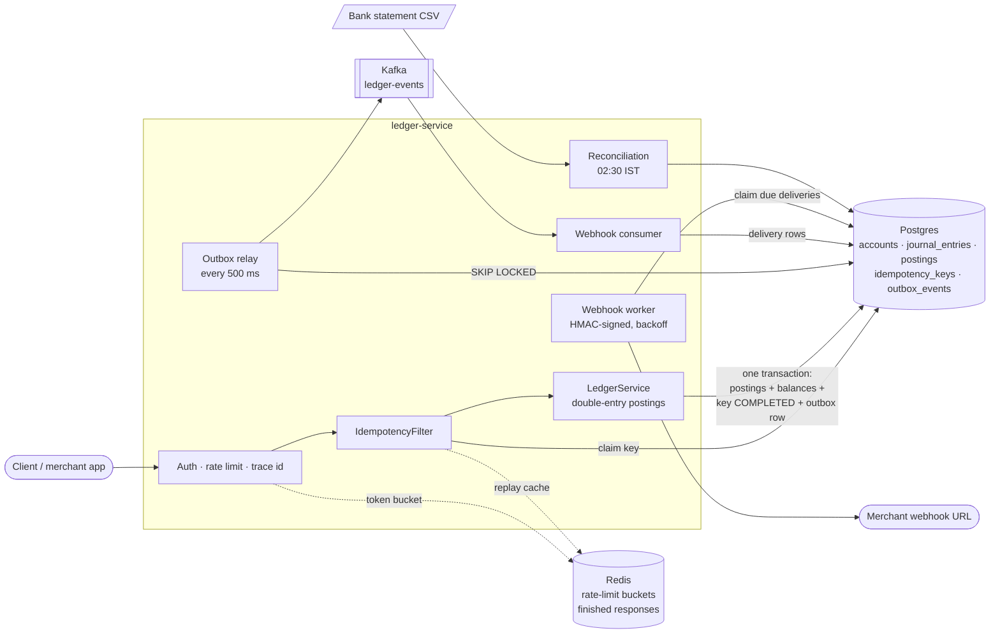

# ledger-service

A double-entry payments ledger for INR wallets: top-ups, wallet-to-wallet transfers, merchant payments, refunds, webhooks and nightly reconciliation. It's built so that money never appears or disappears, and a retried request never charges twice.

Java 21 · Spring Boot 3 · Postgres 16 · Redis 7 · Kafka 3.8 · k6 · Prometheus/Grafana

**On one laptop** (i7-10510U, everything in Docker):

- **150 transfers/s**, p95 143 ms, 0 deadlocks.
- A retry storm of **9,600 requests for 2,400 transfers** created **0 duplicate entries**.
- The app was killed mid-traffic and recovered with **200/200 transfers, none doubled**.
- Throughput tops out at about **340 req/s**, limited by Postgres.

Full numbers: [docs/results.md](docs/results.md).

## Run it

Needs Docker only.

```bash
docker compose up -d --build          # app + Postgres, Redis, Kafka, Prometheus, Grafana
docker compose run --rm loadtest      # the four k6 scenarios, ~12 min → load/results/SUMMARY.md
```

- API: http://localhost:8080 (Swagger UI at `/swagger-ui.html`)
- Grafana: http://localhost:3000 (the "Ledger Service" dashboard)
- Failure drills: `bash drills/kill-app.sh`, `kafka-outage.sh`, `redis-outage.sh` and `corrupt-balance.sh` (Git Bash works on Windows)
- Tests: `./mvnw test` (needs Java 21; Testcontainers starts its own Postgres, Redis and Kafka)

The compose stack registers a dev admin key, `lk_dev_admin_key_for_local_use_only_0000000000`; set `LEDGER_ADMIN_API_KEY` to override it. Every `/v1` call needs `Authorization: Bearer <key>`:

```bash
KEY=lk_dev_admin_key_for_local_use_only_0000000000
api() { curl -s -H "Authorization: Bearer $KEY" -H 'Content-Type: application/json' "$@"; echo; }

api -X POST localhost:8080/v1/users -d '{"email":"asha@example.com"}'   # → walletAccountId, e.g. 2
api -X POST localhost:8080/v1/users -d '{"email":"ravi@example.com"}'   # → 3

# ₹1,200 into Asha's wallet (amounts are in paise)
api -X POST localhost:8080/v1/topups -H "Idempotency-Key: $(uuidgen)" -d '{"accountId":2,"amount":120000}'

# Asha sends Ravi ₹500. Run it twice with the same key: the second answer is a replay, not a second transfer.
K=$(uuidgen)
api -X POST localhost:8080/v1/transfers -H "Idempotency-Key: $K" -d '{"fromAccountId":2,"toAccountId":3,"amount":50000}'
api -X POST localhost:8080/v1/transfers -H "Idempotency-Key: $K" -d '{"fromAccountId":2,"toAccountId":3,"amount":50000}' -i | grep -i replayed

api localhost:8080/v1/accounts/2/statement
```

## Architecture



One request, end to end:

1. The API key is checked (SHA-256 hash lookup, cached for 30 s), the Redis token bucket is charged, and an `X-Request-Id` is attached.
2. If Redis already has a finished response for the `Idempotency-Key`, it's replayed and the request ends there.
3. Otherwise the key is claimed in Postgres with `INSERT … ON CONFLICT`. Losers get the stored result, a 409 while the request is still running, or a 422 if the body differs.
4. In **one transaction**, the service:
   - locks the user wallets (lowest id first);
   - checks balances;
   - writes the journal entry and its postings, which sum to 0;
   - updates the cached balances;
   - marks the key COMPLETED with the response;
   - inserts the `*.completed` outbox event.
5. After the commit, the response is copied to Redis. The relay publishes the event to Kafka, and the webhook pipeline delivers it to the merchant.

## Design decisions

| Decision | Instead of | Why |
| --- | --- | --- |
| Amounts in **paise, `BIGINT`** | `DECIMAL` rupees, or floats | Integer maths is exact and fast. ₹1 crore fits easily. Floats can't represent 0.1. |
| **Double-entry**: every movement is one entry whose postings sum to 0; tables are append-only (triggers reject UPDATE/DELETE); a seeded `SYSTEM_CLEARING` account is the source of top-ups | A `balance` column changed in place | Money can't appear from nowhere. `SUM(postings) = 0` is a one-line audit, and mistakes get reversing entries, never edits. |
| **Cached balance** on `accounts`, updated in the same transaction, plus a `CHECK (balance >= 0)` for wallets | Summing postings on every read | Reads stay O(1). Reconciliation proves the cache matches the postings every night. |
| **Pessimistic locks** (`SELECT … FOR UPDATE`) on user wallets, **in id order**; hot house accounts updated last and not locked up front | Optimistic versioning plus retries; locking every account | Transfers between the same wallets would mostly conflict and retry under optimistic locking. Fixed order means no deadlocks (0 in every run). Not locking the merchant row up front fixed a convoy that capped throughput at 40 req/s ([docs/operations.md](docs/operations.md#found-while-testing-throughput-collapsed-on-hot-accounts-at-40-reqs-fixed)). |
| **Idempotency in Postgres** (primary-key claim, lease, claim token), with Redis only as a cache of finished responses | Redis `SETNX` as the lock | The claim, the money movement and the stored response share one database transaction. An unfinished key therefore always means no money moved, and a crash can't leave a "charged but not recorded" state. Redis can be wiped or down without breaking anything. |
| **Transactional outbox** plus a polling relay with `FOR UPDATE SKIP LOCKED` | Publishing to Kafka inside or after the transaction; Debezium CDC | An event exists if and only if the money moved, with no dual write. Polling is simpler to run than CDC at this scale. The cost is at-least-once delivery (consumers dedupe by `eventId`) and up to about 0.5 s of lag. |
| **Webhooks from a delivery table**, HMAC-SHA256 signed, exponential backoff 1 s → 1 h, dead-letter after 15 attempts | Calling the merchant inline from the payment request | A slow or failing merchant can't slow payments down, and every attempt is recorded and replayable. |
| **Fail fast on overload**: Hikari's timeout is 3 s, then 503 with `Retry-After` | Letting requests queue | A queue just converts overload into timeouts for everyone. Clients that retry with the same key get the right answer later. |
| **Redis fails open** for rate limits and replays | Rejecting traffic when Redis is down | Redis isn't the source of truth. Correctness never depended on it: the [Redis drill](docs/results.md#redis-down-redis-outagesh) kept 200/200 transfers correct. |

Deeper write-ups:

- [concurrency](docs/concurrency.md): what broke before the locking, with the numbers;
- [idempotency](docs/idempotency.md);
- [outbox](docs/outbox.md);
- [webhooks and reconciliation](docs/webhooks-and-reconciliation.md);
- [operations](docs/operations.md);
- [How I stopped double charges](docs/blog-how-i-stopped-double-charges.md), the short version as a blog post.

## Results

Load (k6, details and per-step tables in [docs/results.md](docs/results.md)):

| Scenario | Throughput | p50 / p95 / p99 | Correctness |
| --- | --- | --- | --- |
| Steady transfers, 10k wallets | 150 req/s | 22 / 143 / 293 ms | 0 errors, 0 deadlocks |
| Hot merchant (one account credited by every request) | 100 req/s | 12 / 185 / 713 ms | 0 errors, 0 deadlocks |
| Retry storm (3 concurrent copies per key, plus a late retry) | 160 req/s | 6 / 15 / 33 ms | 2,400 transfers, **0 duplicate entries** |
| Ramp 20 → 400 req/s, mixed traffic | flat at ~340 req/s | p95 < 250 ms up to 325 req/s | 100% checks; 9 fast 503s at the top |

The ramp also exposed an outbox relay that published one event per Kafka round trip, about 200 events/s. Pipelining its sends cut the peak event backlog from 20,303 to 1,278 in a before/after run ([details](docs/results.md#4-ramp-20--400-reqs-over-4-minutes-70-transfers-20-payments-to-10-merchants-10-top-ups)).

Failure drills (every one ends with `SUM(postings) = 0` and no balance drift):

| Drill | What happened |
| --- | --- |
| `docker kill` the app with 200 transfers in flight | 86 had committed, 114 lost their connection. Retrying with the same keys gave 200/200 transfers, none doubled. |
| Kafka stopped for 5 minutes under traffic | All 739 transfers succeeded. The outbox backlog peaked at 739 and drained 19 s after Kafka was restarted, with 0 events lost. |
| Redis stopped | Every transfer and replay was still correct, with replays served from Postgres; about 0.8 s slower per request |
| Balance edited by hand in SQL | Reconciliation flagged exactly that account (`BALANCE_DRIFT`, +100 paise) |
| Merchant endpoint failing 50% | All events delivered, each once after dedupe (`WebhookDeliveryTest`) |

## API

| Method | Path | What it does | Errors |
| --- | --- | --- | --- |
| POST | `/v1/users` | Create a user and an empty INR wallet | 400 invalid email, 409 `EMAIL_EXISTS` |
| GET | `/v1/accounts/{id}` | Balance and account details | 404 `ACCOUNT_NOT_FOUND` |
| GET | `/v1/accounts/{id}/statement?cursor=&limit=` | Postings newest first, cursor-paginated (limit 1–100, default 20) | 400, 404 |
| POST | `/v1/topups` | Add money to a wallet from the clearing account | 400, 404, 422 `NOT_A_WALLET` |
| POST | `/v1/transfers` | Wallet to wallet | 402 `INSUFFICIENT_FUNDS`, 404, 422 `SAME_ACCOUNT` |
| GET | `/v1/journal-entries/{id}` | One entry with all its postings | 404 `ENTRY_NOT_FOUND` |
| POST | `/v1/merchants` | Create a merchant and its settlement account | 400 |
| POST | `/v1/payments` | Wallet to merchant (`merchantId`, `amount`) | 402, 404 `MERCHANT_NOT_FOUND`, 422 `NOT_A_WALLET` |
| GET | `/v1/payments/{id}` | Payment, its status and refunds | 404 `PAYMENT_NOT_FOUND` |
| POST | `/v1/payments/{id}/refunds` | Refund part (`amount`) or all of what's left (`{}`) | 404, 422 `REFUND_EXCEEDS_PAYMENT`, 422 `PAYMENT_FULLY_REFUNDED` |
| POST | `/v1/webhooks` | Register a merchant callback URL; returns its signing secret | 400 `INVALID_URL`, 404, 409 `SUBSCRIPTION_EXISTS` |
| GET | `/v1/admin/reconciliation/latest` | Latest reconciliation report and its mismatches | 404 `NO_RECONCILIATION_RUNS` |
| POST | `/v1/admin/reconciliation/runs?date=` | Run reconciliation now (default: yesterday) | 400 |
| POST | `/v1/admin/fake-bank/statements?date=&fault=` | Demo only: write the statement a bank would send | 400 |
| POST | `/v1/admin/api-keys` | Create a CLIENT or ADMIN key (shown once), optional rate limit | 400 |
| DELETE | `/v1/admin/api-keys/{id}` | Revoke a key | 404 |

- All `/v1` calls need `Authorization: Bearer <api key>`: 401 without one, 403 for admin paths with a CLIENT key.
- Calls are rate limited per key (429 with `Retry-After`).
- Every response has an `X-Request-Id`, and errors look like `{ "code": "...", "message": "...", "traceId": "..." }`.

Every money-moving POST needs an `Idempotency-Key` header. Keys are scoped to the API key and remembered for 24 hours:

| Same key, and… | Response |
| --- | --- |
| same request, finished | the original response, with `Idempotent-Replayed: true` |
| same request, still running | 409 `REQUEST_IN_PROGRESS` |
| a different request | 422 `IDEMPOTENCY_KEY_REUSED` |

## Tests

`./mvnw test` runs 185 tests against real Postgres, Redis and Kafka (Testcontainers). The ones that matter most:

- `LedgerInvariantTest`: 1,000 random transfers between 20 wallets. Then it checks that postings sum to 0, every cached balance equals its postings, the total is conserved, and nothing is negative.
- `ConcurrentTransferTest`: 200-thread races, 20 times over. One drains a single wallet (exactly 100 of 200 succeed). The other sends opposite-direction transfers (all succeed, no deadlocks).
- `ConcurrentDuplicateTest`: one transfer sent 100 times in parallel with one key, 10 times over, giving exactly one entry each time.
- `OutboxCrashRecoveryTest`: the JVM is killed between commit and publish, and the event still arrives exactly once.
- `WebhookDeliveryTest`, `ReconciliationTest`, `RedisDownTest`, `RateLimitTest` and more.

## What I'd do next

- **Circuit breaker around Redis**, so an outage costs one 250 ms timeout, not three per request.
- **Claim the idempotency key in the business transaction**, saving one DB round trip and one connection per request. That matters because the pool is the bottleneck at 340 req/s.
- **Shard house accounts** (merchant and clearing balances split across N sub-accounts) or drop their cached balance, to remove the last hot row.
- **Read replicas** for statements and the dashboard; partition `postings` by month.

## Out of scope

Real payment gateways, KYC, a frontend, multiple currencies, sharding across databases.
